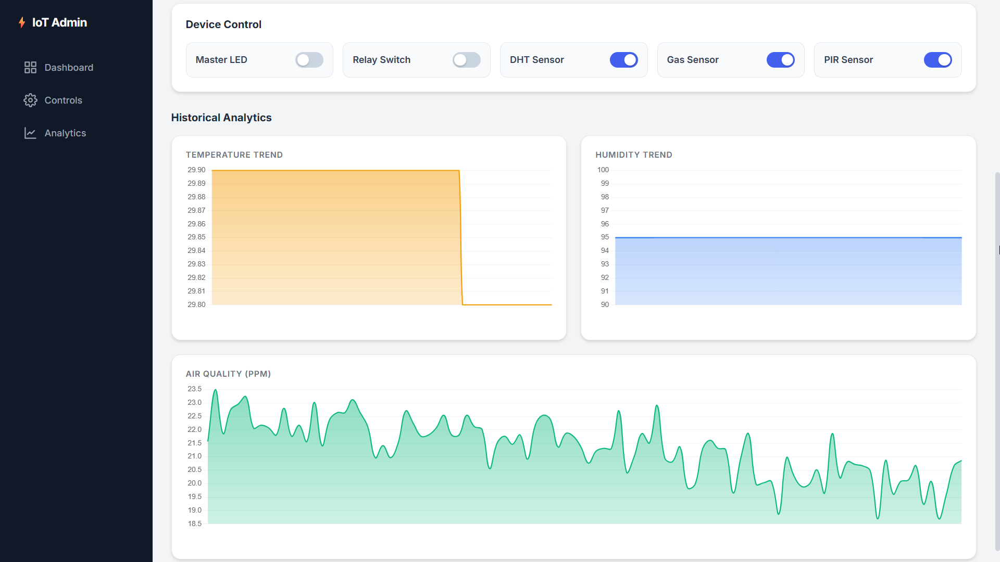
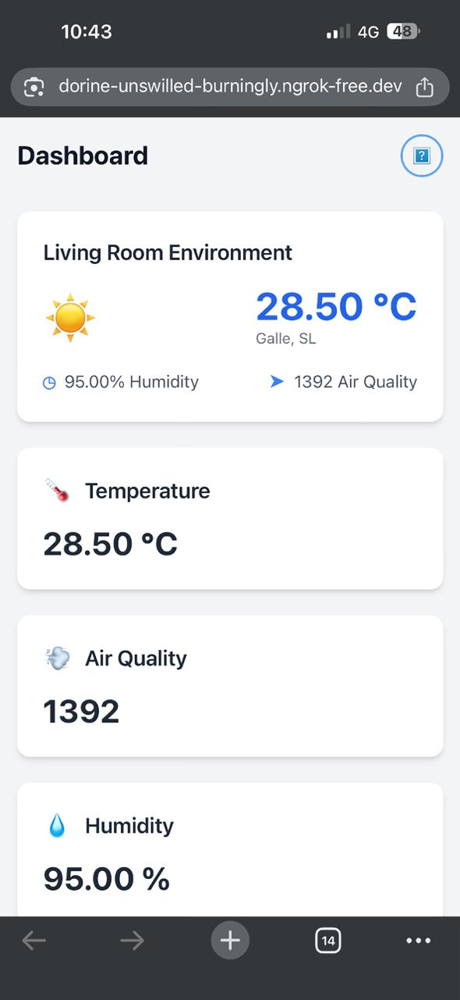

# Building an ESP32 IoT Smart Home Dashboard


This project creates a complete data loop between your physical room and a web interface. It involves sensing environmental data using an ESP32 microcontroller, processing it via a Python Flask backend, and visualizing it on a custom-built dashboard.

#### Desktop View - Live Sensor Widgets


### Desktop View - Historical Data Charts



#### Mobile Responsive View



---

## How It Works

The system operates in three main stages:

1. **Sensing & Processing:** The ESP32 continuously reads data from DHT11 (Temp/Humidity) and MQ-2 (Gas/Smoke) sensors. It calculates PPM values for gas and monitors motion via a PIR sensor, publishing everything to a public MQTT broker (HiveMQ).
2. **Data Management & Server:** A Python Flask server subscribes to the MQTT broker. When data arrives, it logs it into a SQLite database (`sensor_data.db`) to maintain a history of readings.
3. **Visualization & Control:** The web dashboard visualizes live data and trends. Toggling a switch on the UI sends a request to the Python server, which publishes a command back to the ESP32 to trigger physical hardware (LEDs or Relays).

## Project Features

- **Real-time** data for Temperature, Humidity, Air Quality (in PPM), and Motion.
- Sensor data is logged to a database and visualized with **interactive charts**.
- Toggle physical devices (LED and 5V Relay) directly from the dashboard.
- Individually **enable or disable** specific sensors (DHT, Gas, PIR) to save power.
- **Uses MQTT** for fast, lightweight communication.
- A professional **"Glassmorphism" design** built with Tailwind CSS.
- Accessible from anywhere in the world **using a secure ngrok** tunnel.

## Project Data Flow

The data flows through the system in two main ways:

* **Sensor Data (ESP32 to Dashboard):** ESP32 (Sensors) → MQTT Broker → Python Backend (Flask) → SQLite Database & Web Frontend
* **Control (Dashboard to ESP32):** Web Frontend → Python Backend → MQTT Broker → ESP32 (Toggles LED, Relay & Logic)

---

## Hardware Requirements

- ESP32 Development Board
- DHT11 (Temperature & Humidity Sensor)
- MQ-2 (Smoke/Gas Sensor)
- HC-SR501 (PIR Motion Sensor)
- 5V Relay Module (JQC3F-05VDC-C)
- 1x LED & 330 Ohm Resistor
- Breadboard and Jumper Wires

      

<p class="caption">Figure 4: Physical Hardware Setup on Breadboard</p>


## Software & Libraries

### 1. ESP32 (Arduino IDE)
You will need to install the following libraries via the Arduino Library Manager:
- [PubSubClient](https://github.com/knolleary/pubsubclient) (by Nick O'Leary)
- [DHT sensor library](https://github.com/adafruit/DHT-sensor-library) (by Adafruit)
- [Adafruit Unified Sensor](https://github.com/adafruit/Adafruit_Sensor) (by Adafruit)

### 2. Python Backend (Your PC)
You will need Python 3 and the following libraries:

```bash
pip install Flask paho-mqtt
```

**Project Files:**


Download the source code to get started:

* [Download ESP32 Firmware (.ino)](/esp32-code/esp32_sketch.ino)
* [Download Python Backend (.py)](/app.py)
* [Download HTML Dashboard Template (.html)](/templates/index.html)

---

## Step-by-Step Project Flow

### Part 1: Hardware Setup

Wire your components to the ESP32. The pins below match the provided code:

* **DHT11 (DATA):** → GPIO 4
* **MQ-2 Sensor (A0):** → GPIO 34
* **PIR Sensor (OUT):** → GPIO 23
* **LED (Positive Leg):** → 330 Ohm Resistor → GPIO 25
* **Relay Module (IN):** → GPIO 26
* **Power:** Connect Relay VCC to VIN (5V). Connect all GND pins to ESP32 GND.

### Part 2: Device (ESP32) Configuration

1.  Open your ESP32 sketch (`.ino` file) in the Arduino IDE.
2.  Install the libraries listed above.
3.  Update the Wi-Fi credentials at the top of the file:

```cpp
const char* ssid = "YOUR_WIFI_SSID";
const char* password = "YOUR_WIFI_PASSWORD";
```

4. Upload the code to your ESP32.
5. Open the Serial Monitor (115200 baud). Wait for the "Clean Air Calibration" to finish.

### Part 3: Backend (Python) Setup

1. Create a project folder (e.g., iot-dashboard).
2. Inside it, place your Python script `app.py`.
3. Create a folder named `templates`.
5. Place the `index.html` file inside the `templates` folder.
6. Open a terminal in your project folder and install dependencies: 

```bash
pip install Flask paho-mqtt
```

### Part 4: Running the System Locally

1. Ensure your ESP32 is powered on.
2. Run the Flask app:

```Bash
python app.py
```

3. The server will start, connect to MQTT, and generate the `sensor_data.db` file.
4. Open your browser to `127.0.0.1:5000`.

### Part 5: Public Access with ngrok

To access your dashboard from your phone or outside your home:
1. Download ngrok and authenticate it.
2. With `app.py` running, open a new terminal and run:

```Bash
ngrok http 5000
```

3. Use the generated `https://...ngrok.io` URL on any device.

---

## Future Improvements

- **Permanent Cloud Deployment**: Deploy the `app.py` to a VPS or cloud platform for 24/7 uptime without a PC.

- **Private Broker**: Switch from the public HiveMQ broker to a private Mosquitto instance for enhanced security.

- **PCB Design**: Move from a breadboard to a custom printed circuit board for a cleaner hardware look.


<br>