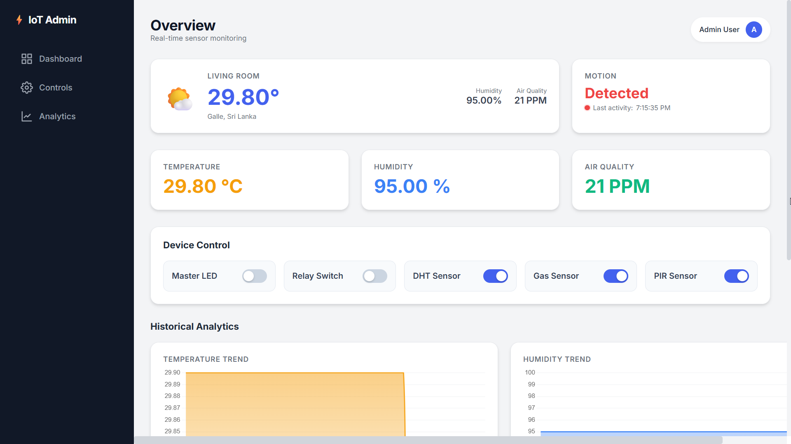
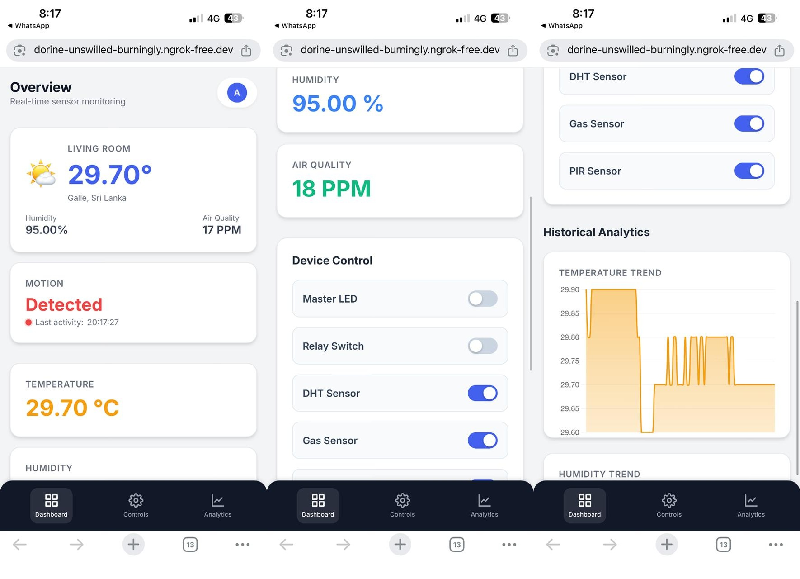

# ESP32 IoT Smart Home Dashboard

<a href="https://github.com/anjulameegalla/SmartHome" target="_blank">
  
</a>
<a href="https://dorine-unswilled-burningly.ngrok-free.dev/" target="_blank">
  
</a>


### Dashboard - Desktop View



### Dashboard - Mobile View
 


<br>

## 📖 How It Works

This project creates a complete data loop between your physical room and a web interface.

**1. Sensing & Processing:**
The ESP32 microcontroller continuously reads data from the DHT11 (Temp/Humidity) and MQ-2 (Gas/Smoke) sensors. It performs onboard mathematical calculations to convert the analog gas signal into a PPM (Parts Per Million) value. It also monitors the PIR sensor for motion. This data is packaged and published to a public MQTT broker (HiveMQ) over Wi-Fi.

**2. Data Management & Server:**
A Python Flask server running locally acts as the central brain. It subscribes to the MQTT broker to receive the sensor data in real-time. When data arrives, the server logs it into a persistent SQLite database (`sensor_data.db`). This allows the system to maintain a history of readings even if the browser is closed.

**3. Visualization & Control:**
The web dashboard fetches this data via API endpoints exposed by the Flask server. It visualizes live data in widgets and historical trends in charts. When you toggle a switch (like the LED or Relay), the browser sends a request to the Python server, which then publishes a command back to the MQTT broker. The ESP32 receives this command instantly and triggers the physical hardware.

---

## ✨ Features

- **Live Sensor Monitoring:** Real-time data for Temperature, Humidity, Air Quality (in PPM), and Motion.
- **Historical Analytics:** Sensor data is logged to a database and visualized with interactive charts (Temperature, Humidity, and Air Quality trends).
- **Advanced Two-Way Control:** - Toggle physical devices (LED and 5V Relay) directly from the dashboard.
- **Remote Sensor Management:** Individually enable or disable specific sensors (DHT, Gas, PIR) to save power or stop data collection.
- **Robust Architecture:** Uses MQTT for fast, lightweight communication between the device and server.
- **Modern Responsive UI:** A professional "Glassmorphism" design built with Tailwind CSS that adapts perfectly to desktop and mobile screens.
- **Public Access:** Accessible from anywhere in the world using a secure `ngrok` tunnel.

<br>

## 🏛️ Project Architecture

The data flows through the system in two main ways:

**1. Sensor Data (ESP32 to Dashboard):** `ESP32 (Sensors)` → `MQTT Broker` → `Python Backend (Flask)` → `SQLite Database` & `Web Frontend`

**2. Control (Dashboard to ESP32):** `Web Frontend` → `Python Backend` → `MQTT Broker` → `ESP32 (Toggles LED, Relay, & Logic)`

---

## 🛠️ Hardware Requirements

- ESP32 Development Board 
- DHT11 (Temperature & Humidity Sensor) 
- MQ-2 (Smoke/Gas Sensor) 
- HC-SR501 (PIR Motion Sensor) 
- 5V Relay Module (JQC3F-05VDC-C)
- 1x LED 
- 1x 330 Ohm Resistor (for the LED) 
- Breadboard and Jumper Wires 

<!--img src="/assets/hardware.jpeg" style="width: 350px;" alt="Hardware Setup"-->


## 💻 Software & Libraries

### 1. ESP32 (Arduino IDE) 

You will need to install the following libraries via the Arduino Library Manager:

- `PubSubClient` (by Nick O'Leary)
- `DHT sensor library` (by Adafruit)
- `Adafruit Unified Sensor` (by Adafruit)

### 2. Python Backend (Your PC) 

You will need Python 3 and the following libraries:

```bash
pip install Flask paho-mqtt
```

---
## 🚀 Step-by-Step Project Flow

### Part 1: Hardware Setup

Wire your components to the ESP32. The pins below match the provided code.

*   **DHT11 (DATA):** → GPIO 4
    
*   **MQ-2 Sensor (A0):** → GPIO 34
    
*   **PIR Sensor (OUT):** → GPIO 23
    
*   **LED (Positive Leg):** → 330 Ohm Resistor → GPIO 25
    
*   **Relay Module (IN):** → GPIO 26
    
*   **Power:** - Connect Relay VCC to **VIN** (5V).
    
    *   Connect other sensors to 3.3V or 5V as required.
        
    *   Connect all GND pins to ESP32 GND.
        

### Part 2: Device (ESP32) Configuration

1.  Open your ESP32 sketch (`.ino` file) in the Arduino IDE.
    
2.  Install the libraries listed above.
    
3.  Update the Wi-Fi credentials at the top of the file:
    
```C++
const char* ssid = "YOUR_WIFI_SSID";
const char* password = "YOUR_WIFI_PASSWORD";
```
    
4.  Upload the code to your ESP32.
    
5.  Open the **Serial Monitor** (115200 baud). Wait for the "Clean Air Calibration" to finish.
    

### Part 3: Backend (Python) Setup

1.  Create a project folder (e.g., `iot-dashboard`).
    
2.  Inside it, place your Python script: `app.py`.
    
3.  Create a folder named `templates`.
    
4.  Place the `index.html` file **inside** the `templates` folder.
    
5.  Open a terminal in your project folder and install dependencies:
    
```Bash
python -m pip install Flask paho-mqtt
```   

### Part 4: Running the System Locally

1.  Ensure your ESP32 is powered on.
    
2.  Run the Flask app:
    
```Bash
python app.py
```
    
3.  The server will start, connect to MQTT, and generate the `sensor_data.db` file.
    
4.  Open your browser to: **`http://127.0.0.1:5000`**
    

### Part 5: Public Access with ngrok

To access your dashboard from your phone or outside your home:

1.  Download `ngrok` and authenticate it.
    
2.  With `app.py` running, open a **new terminal** and run:
    
```Bash
ngrok http 5000
```
    
3.  Use the generated `https://...ngrok.io` URL on any device.
    

---

## 🚀 Future Improvements

*   **Permanent Cloud Deployment:** Deploy the `app.py` to a VPS or cloud platform for 24/7 uptime without a PC.
    
*   **Private Broker:** Switch from the public HiveMQ broker to a private Mosquitto instance for enhanced security.
    
*   **PCB Design:** Move from a breadboard to a custom printed circuit board for a cleaner hardware look.