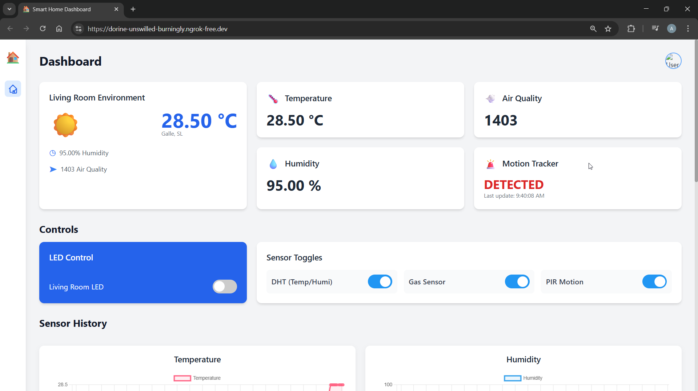
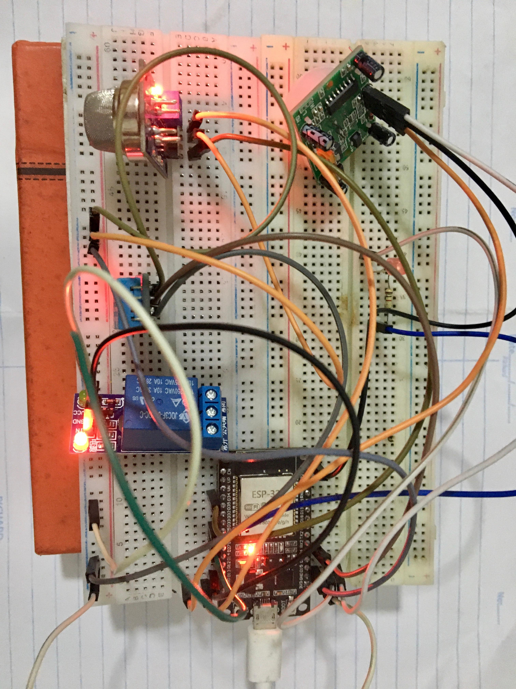

# ESP32 IoT Smart Home Dashboard


#### Dashboard - Desktop View


#### Dashboard - Mobile View


## ✨ Features

- **Live Sensor Monitoring:** Real-time data for Temperature, Humidity, Air Quality, and Motion.
- **Historical Data:** All sensor data is logged to an SQLite database and displayed in historical graphs using Chart.js.
- **Two-Way Control:** A toggle switch on the dashboard sends an MQTT command back to the ESP32 to control a physical LED. Update: Added more switches to control (Enable/disable) other sensors.
- **MQTT-Based:** Built on a lightweight and fast MQTT architecture for efficient data transmission.
- **Python Backend:** A robust Flask server manages data, serves the web page, and handles API requests.
- **Modern Frontend:** A beautiful, responsive dashboard built with Tailwind CSS that works on both desktop and mobile.
- **Public Access:** Includes instructions for exposing the local dashboard to the public internet using ngrok.

<br>

## 🏛️ Project Architecture

The data flows through the system in two main ways:

**1\. Sensor Data (ESP32 to Dashboard):** ESP32 (Sensors) → MQTT Broker → Python Backend (Flask) → SQLite Database & Web Frontend (Browser)

**2\. Control (Dashboard to ESP32):** Web Frontend (Browser) → Python Backend (Flask) → MQTT Broker → ESP32 (LED, Sensors)

---

## 🛠️ Hardware Requirements

- ESP32 Development Board
- DHT11 (Temperature & Humidity Sensor)
- MQ-135 or similar (Air Quality/Gas Sensor)
- HC-SR501 (PIR Motion Sensor)
- 1x LED
- 1x 330 Ohm Resistor (for the LED)
- Breadboard and Jumper Wires



## 💻 Software & Libraries

### 1\. ESP32 (Arduino IDE)

You will need to install the following libraries via the Arduino Library Manager:

- PubSubClient (by Nick O'Leary)
- DHT sensor library (by Adafruit)
- Adafruit Unified Sensor (by Adafruit)

### 2\. Python Backend (Your PC)

You will need Python 3 and the following libraries (install via pip):

- Flask
- paho-mqtt

```Bash
# Install required Python packages

python -m pip install Flask paho-mqtt
``` 

---

## 🚀 Step-by-Step Project Flow

Here is the complete flow, from setting up the hardware to viewing the public dashboard.

### Part 1: Hardware Setup

Wire your components to the ESP32. The pins below match the provided code.

- **DHT11 (DATA):** → GPIO 4
- **MQ Sensor (A0):** → GPIO 34
- **PIR Sensor (OUT):** → GPIO 23
- **LED (Positive Leg):** → 330 Ohm Resistor → GPIO 25
- **Power:** Connect all VCC pins to VIN (5V) and all GND pins to GND.

### Part 2: Device (ESP32) Configuration

This step gets your physical device online and publishing data.

- Open your ESP32 sketch (.ino file) in the Arduino IDE.
- Install the libraries listed above.
- Update the Wi-Fi credentials at the top of the file:

```C++
const char\* ssid = "YOUR_WIFI_SSID";
const char\* password = "YOUR_WIFI_PASSWORD";
```
- Upload the code to your ESP32.
- Open the **Serial Monitor** (set to 115200 baud).
- Wait for the PIR calibration to complete. You should see it connect to your Wi-Fi and then successfully connect to the MQTT broker ("...connected").
- It will start printing "Sensor data published!"

### Part 3: Backend (Python) Setup

This step sets up the web server on your computer that will receive the data.

- Create a project folder on your computer (e.g., iot-dashboard).
- Inside it, place your Python script: app.py.
- Inside the same folder, create a new folder named templates.
- Place your HTML file (index.html) **inside** the templates folder.
- Open a terminal or Command Prompt and navigate into your iot-dashboard folder.
- Install the Python dependencies (if you haven't already):

```bash
python -m pip install Flask paho-mqtt
```

### Part 4: Running the Full System Locally

Now you'll run the backend and see everything work on your local network.

- Make sure your ESP32 is plugged in and running (publishing data).
- In your terminal (still in the iot-dashboard folder), run the Flask app:

```Bash
python app.py
```
- You will see the server start up. It will connect to the MQTT broker and create the sensor_data.db file.
- Open your web browser (Chrome, Firefox, etc.).
- Go to this address: **<http://127.0.0.1:5000>** (or <http://localhost:5000>).
- **Done!** You should see your full dashboard, with live data cards updating and history charts loading. Try clicking the LED control switch!

### Part 5: Public Dashboard with ngrok

This final step makes your local dashboard visible to anyone on the internet.

- Download ngrok (a single file) from their website.
- (One-time setup) Sign up for a free account to get an authtoken. Run this in your terminal:

```Bash
ngrok authtoken YOUR_TOKEN_HERE
```

- Keep your app.py script running in its terminal.
- Open a **new, second terminal** and run this command:

```Bash
ngrok http 5000
```

- ngrok will give you a public URL (e.g., <https://random-string.ngrok.io>).
- You can now access your full dashboard from any device in the world using that https://... URL.

---

## 🚀 Future Improvements

- **Permanent Deployment:** Deploy the app.py script to a 24/7 cloud service like PythonAnywhere, Heroku, or a VPS.
- **Custom MQTT Broker:** Set up your own private MQTT broker (like Mosquitto) on a Raspberry Pi or in the cloud for better security and privacy.